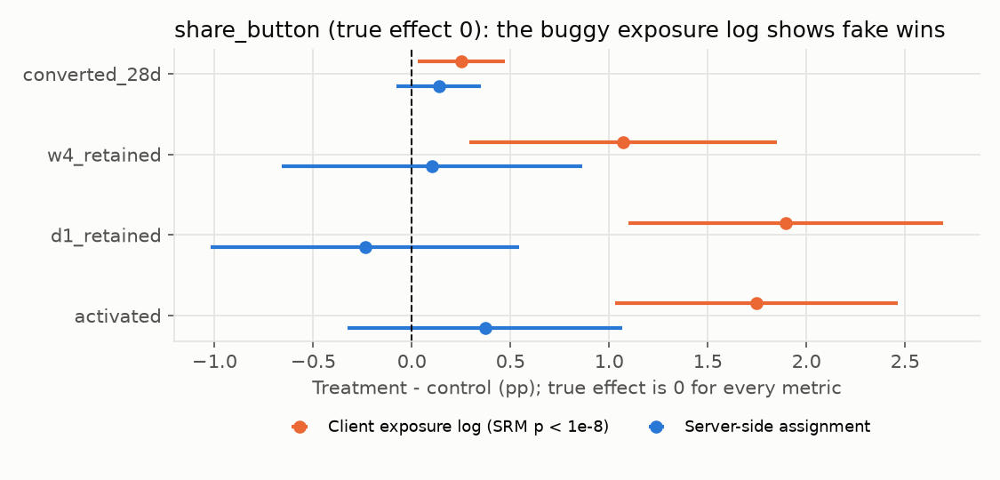

# growth-experimentation-lab

Product data science for a freemium AI creation app: **A/B test design and readouts, the classic
ways experiments go wrong, and growth analytics (funnel, retention, resurrection, LTV) in SQL**.
Every analysis is scored against the true answer.

> **All data is simulated**: 120,000 users over 8 weeks, with activity, a credit-limited free tier,
> a paywall and Stripe-style subscriptions and invoices. The same users are simulated under each
> experiment assignment with identical random draws, so every true effect is known exactly.
> No real company or customer data is used.

## What it shows (full tables in [RESULTS.md](RESULTS.md))

| Problem planted | What the analysis found | Truth |
|---|---|---|
| **Sample-ratio mismatch**: a logging bug drops Android treatment users who don't come back | Exposure log is 48.8% treatment (SRM p = 2e-9); analysed on it, a no-effect feature "wins" on all 6 metrics (activation +1.7pp, p = 2e-6). On server-side assignment: no effect | 0 |
| **Novelty effect** in a new onboarding flow | Daily-active lift +7.2pp on day 1, +0.5pp by week 4; week-4 retention +0.9pp [+0.1, +1.7] | +0.6pp |
| **Interaction** between two overlapping tests | Template gallery adds +1.9pp W4 retention alone but −0.7pp with the new onboarding; interaction −2.5pp [−4.7, −0.4] | −2.9pp |
| **Price test** ($12 vs $15) with country differences | Conversion −5.9pp (−22%); revenue not distinguishable from 0 (needs ~3 years of traffic); ROW revenue −$0.48 per user, the only segment significant after Benjamini-Hochberg | ROW −$0.59 |
| **Wrong unit of analysis** for a ratio metric | A/A tests: naive day-level t-test 14.7% false positives vs 4.7% with the delta method | 5% |
| **Sizing from correlations** | Activated-vs-not gap implied +2.2pp retention from the onboarding lift; the test measured +0.9pp | +0.6pp |
| **LTV projection** at 84 days | Renewal-based projection within 2–12% of realised 150-day revenue per signup; straight-line extrapolation off by 35–52% | — |

All 18 experiment confidence intervals (3 tests × 6 metrics) contain the true effect.



## Layout

| Path | Contents |
|---|---|
| `gel/sim.py` | Simulator: users, daily activity, credits and paywall, subscriptions, invoices, 4 experiments, truth worlds |
| `sql/00_sources.sql`, `sql/10_metrics.sql` | Warehouse views and **the** metric definitions (activation, D1, W4, conversion, revenue, price-test outcomes) |
| `sql/20_growth.sql` | Funnel, retention curves, cohort triangle, resurrection, MRR reconciliation (dashboard tiles) |
| `gel/stats.py` | SRM, Welch difference, CUPED, regression adjustment, delta method, Benjamini-Hochberg, MDE / sample size |
| `gel/study.py` | Activation threshold, retention drivers, experiment readouts, novelty, interaction, price test, A/A, sizing, LTV |
| `EXPERIMENT_PLAYBOOK.md` | Standards for sizing, SRM, peeking, CUPED, multiple comparisons, novelty, interactions, readouts |
| `dashboards/METABASE.md` | Dashboard spec mapping each tile to its SQL (not built in Metabase) |

## Run

```bash
pip install -r requirements.txt
python -m gel.build     # simulate -> data/*.parquet + results/truth.json (~40 s)
python -m gel.study     # all analyses through DuckDB SQL -> results/study.json (~25 s)
python -m gel.report && python -m gel.charts   # RESULTS.md + figures
pytest -q               # 11 tests, incl. SQL metric definitions == Python definitions
```

## Limitations

* Simulated behaviour: real users, logging and billing have failure modes this generator lacks.
* SQL runs on DuckDB; the stack named in many job posts (BigQuery, Amplitude, Metabase, Stripe) is
  mirrored in table shapes only, not used.
* CUPED and regression adjustment helped little here (0–5% SE reduction) because pre-period activity is weakly related to
  revenue in this simulation; real gains depend on how predictive the pre-period metric is.
