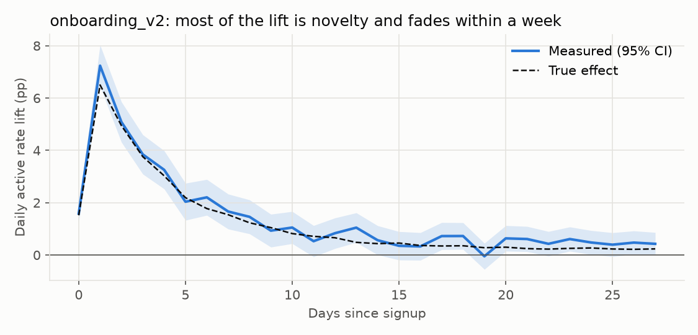
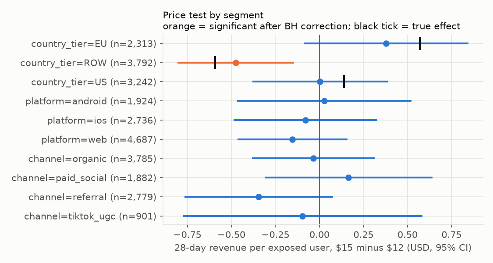

# Results

Simulated data: 120,000 users signing up over 8 weeks, analysed as of day 84 through SQL on warehouse-style tables. Every true effect is known exactly because the same users were simulated under each assignment with identical random draws. No real OpenArt or customer data is used.

## 1. Defining activation

Candidate rule: *generated at least k assets in the first 3 days*. Chosen k maximises the correlation with week-4 retention.

| k | Share activated | W4 retention if activated | if not | Correlation with W4 |
|---:|---:|---:|---:|---:|
| 1 | 92.0% | 37.6% | 19.4% | 0.102 |
| 3 | 65.9% | 43.7% | 21.5% | 0.218 |
| 5 | 42.7% | 50.9% | 25.1% | 0.266 |
| 6 | 33.9% | 54.7% | 26.6% | 0.276 |
| 7 **(chosen)** | 26.9% | 58.4% | 27.9% | 0.281 |
| 8 | 21.1% | 62.0% | 29.2% | 0.278 |
| 10 | 12.4% | 68.7% | 31.5% | 0.256 |

The curve is flat between 5 and 8, so the exact cut-off matters less than using one definition everywhere.

## 2. Experiment readouts (intent-to-treat on server-side assignment, covariate-adjusted)

### share_button  (n = 60,151; SRM p on assignments 0.89, on client exposures 2e-09)

| Metric | Estimate [95% CI] | True effect | CI covers truth | Significant after BH |
|---|---:|---:|:---:|:---:|
| activated | +0.4pp [-0.3, +1.1] | +0.0pp | yes | no |
| d1_retained | -0.2pp [-1.0, +0.5] | +0.0pp | yes | no |
| w4_retained | +0.1pp [-0.7, +0.9] | +0.0pp | yes | no |
| generations_7d | -0.03 [-0.14, +0.09] | +0.00 | yes | no |
| converted_28d | +0.1pp [-0.1, +0.4] | +0.0pp | yes | no |
| revenue_28d | +0.019 [-0.009, +0.046] | +0.000 | yes | no |

### onboarding_v2  (n = 60,095; SRM p on assignments 0.47, on client exposures 0.5)

| Metric | Estimate [95% CI] | True effect | CI covers truth | Significant after BH |
|---|---:|---:|:---:|:---:|
| activated | +7.3pp [+6.6, +8.1] | +6.7pp | yes | yes |
| d1_retained | +7.1pp [+6.4, +7.9] | +6.5pp | yes | yes |
| w4_retained | +0.9pp [+0.1, +1.7] | +0.6pp | yes | yes |
| generations_7d | +1.22 [+1.10, +1.34] | +1.13 | yes | yes |
| converted_28d | +0.3pp [+0.1, +0.5] | +0.2pp | yes | yes |
| revenue_28d | +0.041 [+0.012, +0.070] | +0.024 | yes | yes |

### template_gallery  (n = 59,849; SRM p on assignments 0.70, on client exposures 0.7)

| Metric | Estimate [95% CI] | True effect | CI covers truth | Significant after BH |
|---|---:|---:|:---:|:---:|
| activated | +3.5pp [+2.8, +4.2] | +3.3pp | yes | yes |
| d1_retained | +1.0pp [+0.2, +1.8] | +1.4pp | yes | yes |
| w4_retained | +2.0pp [+1.2, +2.7] | +1.7pp | yes | yes |
| generations_7d | +0.78 [+0.66, +0.90] | +0.74 | yes | yes |
| converted_28d | +0.4pp [+0.2, +0.6] | +0.3pp | yes | yes |
| revenue_28d | +0.053 [+0.024, +0.082] | +0.041 | yes | yes |

All 18 of 18 confidence intervals contain the true effect. Covariate adjustment with signup attributes (channel, platform, country) cut standard errors by only 0-2%: new users have no pre-period behaviour, so CUPED-style variance reduction has little to work with on signup tests.

### The sample-ratio mismatch

The client exposure log has 28,647 treatment vs 30,092 control users (48.8% treatment, chi-square p = 2e-09). On Android the exposure event fires only in a later session, so treatment users who never come back are missing. Analysed on exposures, the no-effect feature looks like a win:

| Metric | On client exposures | On server assignments | Truth |
|---|---:|---:|---:|
| activated | +1.7pp [+1.0, +2.5] (p = 2e-06) | +0.4pp [-0.3, +1.1] | 0 |
| d1_retained | +1.9pp [+1.1, +2.7] (p = 3e-06) | -0.2pp [-1.0, +0.5] | 0 |
| w4_retained | +1.1pp [+0.3, +1.8] (p = 0.007) | +0.1pp [-0.7, +0.9] | 0 |
| converted_28d | +0.3pp [+0.0, +0.5] (p = 0.03) | +0.1pp [-0.1, +0.4] | 0 |

Rule adopted in the playbook: an SRM with p < 0.001 halts the readout until the cause is found.

### Novelty (onboarding_v2)

Average lift in daily active rate is +3.6pp in days 1-7 but +0.5pp in days 21-27. A one-week readout would report D1 retention +7.1pp; the week-4 retention effect is +0.9pp (true +0.6pp). The lasting effect is real but about 8x smaller than the day-1 number.

### Interaction (onboarding_v2 x template_gallery)

29,944 users were in both tests. Model: metric ~ onb * tg + covariates (robust SE).

| Metric | Gallery effect without new onboarding | with new onboarding | Interaction [95% CI] | True interaction |
|---|---:|---:|---:|---:|
| activated | +3.5pp (true +3.4pp) | +2.2pp (true +2.5pp) | -1.3pp [-3.3, +0.7] | -0.9pp |
| w4_retained | +1.9pp (true +2.5pp) | -0.7pp (true -0.5pp) | -2.5pp [-4.7, -0.4] | -2.9pp |

The gallery's week-4 retention gain disappears for users who also get the new onboarding: shipping both does not add up to the sum of the two readouts. The activation interaction is in the right direction but not significant.

## 3. Paywall price test ($12 vs $15)

9,347 users exposed at their first paywall view in the test (SRM p = 0.20); outcome window 28 days.

| Metric | Raw | CUPED (pre-period generations) | Regression-adjusted | True | SE reduction |
|---|---:|---:|---:|---:|---:|
| converted_28d | -5.9pp [-7.6, -4.2] | -5.9pp [-7.6, -4.2] | -5.9pp [-7.6, -4.3] | -5.6pp | 4% |
| revenue_28d | -0.096 [-0.326, +0.135] | -0.094 [-0.316, +0.129] | -0.095 [-0.317, +0.127] | -0.051 | 4% |
| w4_retained | +0.7pp [-1.2, +2.7] | +0.8pp [-1.1, +2.6] | +0.8pp [-1.1, +2.6] | -0.8pp | 5% |

Conversion fell 22% at $15. Revenue per exposed user is not distinguishable from zero, and the true overall effect (-0.051 USD) would need about 194,359 users per arm, roughly 3.1 years at 346 exposures per day. Pre-period activity is only weakly related to revenue, so CUPED helped little.

| Segment | n | Revenue effect [95% CI] | raw p | Significant after BH | True |
|---|---:|---:|---:|:---:|---:|
| country_tier=EU | 2,313 | +0.38 [-0.09, +0.85] | 0.114 | no | +0.57 |
| country_tier=ROW | 3,792 | -0.48 [-0.81, -0.14] | 0.005 | yes | -0.59 |
| country_tier=US | 3,242 | +0.00 [-0.38, +0.39] | 0.984 | no | +0.14 |
| platform=android | 1,924 | +0.03 [-0.47, +0.52] | 0.913 | no | 0 (no planted difference) |
| platform=ios | 2,736 | -0.08 [-0.49, +0.33] | 0.703 | no | 0 (no planted difference) |
| platform=web | 4,687 | -0.15 [-0.47, +0.16] | 0.337 | no | 0 (no planted difference) |
| channel=organic | 3,785 | -0.03 [-0.38, +0.31] | 0.848 | no | 0 (no planted difference) |
| channel=paid_social | 1,882 | +0.17 [-0.31, +0.64] | 0.497 | no | 0 (no planted difference) |
| channel=referral | 2,779 | -0.35 [-0.77, +0.08] | 0.109 | no | 0 (no planted difference) |
| channel=tiktok_ugc | 901 | -0.10 [-0.78, +0.58] | 0.780 | no | 0 (no planted difference) |

Recommendation the data supports: do not raise the price in ROW markets (revenue falls). EU shows a possible gain that this test cannot confirm; a follow-up EU-only test is the next step. Platform and channel splits show nothing.

## 4. Validating the analysis (A/A tests)

2,000 random 50/50 splits of 118,487 real simulated users (true effect 0). Target false-positive rate: 5%.

| Analysis | False-positive rate |
|---|---:|
| Activation, user-level difference | 5.5% |
| Generations per active day, delta method (user = unit) | 5.9% |
| Generations per active day, naive day-level t-test | **16.8%** |

Treating user-days as independent when users are randomised nearly triples false positives.

## 5. Test sizing

About 2,143 signups per day, 50/50 split, 80% power, alpha 0.05.

| Metric | Baseline | MDE (relative), 14 days of signups | 28 days of signups | Days of signups to detect a 5% lift |
|---|---:|---:|---:|---:|
| activated | 26.9% | 5.3% | 3.8% | 16 |
| w4_retained | 36.1% | 4.3% | 3.0% | 10 |
| converted_28d | 1.9% | 23.5% | 16.6% | 310 |
| revenue_28d | $0.241 | 23.7% | 16.7% | 314 |

Days are days of signup traffic; add the metric's own window (e.g. 28 days for W4 retention) before the readout. Signup tests can detect a few-percent change in activation or W4 retention within two weeks, but paid conversion and revenue need many months; for those, use the leading indicators and confirm with a long-running holdout.

## 6. Opportunity sizing from correlations vs. what the test delivered

Before building, a correlational estimate: activation lift (+7.3pp) times the gap between activated and non-activated users.

| Metric | Implied by correlation | Experiment estimate [95% CI] | True effect |
|---|---:|---:|---:|
| w4_retained | +2.2pp | +0.9pp [+0.1, +1.7] | +0.6pp |
| revenue_28d | +0.057 | +0.041 [+0.012, +0.070] | +0.024 |

The correlational sizing overstated the retention effect about 4x: activated users are mostly people who were going to stay anyway. Activation is a useful leading indicator, not a proxy you can multiply through.

## 7. Lifetime value: 150-day revenue per signup (signups days 0-24)

Projection uses only data visible at the cutoff: monthly renewal rate 90.2% and the cycle-over-cycle decline in new subscriptions.

| Channel | Projected | Naive (28-day x 150/28) | Realised (truth) | Projection error | Naive error |
|---|---:|---:|---:|---:|---:|
| referral | $4.98 | $2.98 | $4.59 | +8% | -35% |
| organic | $2.52 | $1.39 | $2.39 | +6% | -42% |
| paid_social | $1.39 | $0.80 | $1.37 | +2% | -42% |
| tiktok_ugc | $1.24 | $0.53 | $1.10 | +12% | -52% |

Referral signups are worth about 4x TikTok signups over 150 days. The projection lands within 2-12% of the realised value; straight-line extrapolation of 28-day revenue misses by 35-52% because most revenue is renewals after day 28.

## Metric definitions

| Metric | Definition |
|---|---|
| activated | generated >= 7 assets in signup days 0-2 |
| d1_retained | active on the day after signup |
| w4_retained | active on any of days 21-27 after signup |
| generations_7d | assets generated in days 0-6 |
| converted_28d | started a paid subscription within days 0-27 |
| revenue_28d | paid invoice amount (USD) within days 0-27 |
